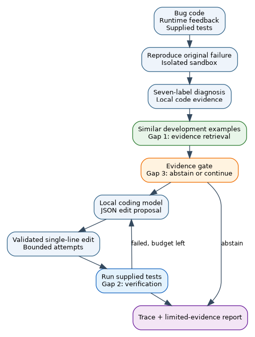

# FaultPilot — G2-08

Fazal Zaman Khan (22I-2362), solo project. FaultPilot diagnoses and attempts bounded repair of Python AI application faults. The Phase 2 implementation is under evaluation; saved measurements below are limited to completed runs.

## Research question and architecture

The fixed Phase 1 base paper is [RepairAgent](https://doi.org/10.1109/ICSE55347.2025.00157). Its original system repairs Java/Defects4J bugs. FaultPilot tests a Python adaptation of its inspect, edit and test loop on the pinned [MLDebugging](https://doi.org/10.18653/v1/2025.findings-acl.305) benchmark. Original RepairAgent results on Java are reported context, not a same-data score.

The three fixed research gaps are: (1) evidence-grounded diagnosis using local code and retrieved development examples, (2) checking a candidate repair against supplied tests in an isolated workspace, and (3) stopping or abstaining when evidence or the attempt budget is insufficient. Each component can be switched off for ablation. Agent state and tool outcomes are saved as JSONL traces.



## Changes since Phase 1

- Added the grouped 941/234 benchmark split, isolated execution harness, development-trained seven-category classifier, evidence retrieval, bounded model edit loop, test verification and evidence gate.
- Changed the unspecified optional model provider to a pinned local Ollama coding model because this machine has no API credential or GPU. The final selected model and digest will be recorded with the repair results.
- Rejected retrieval score fusion on development validation because it reduced macro F1. Retrieval remains available as provenance evidence. The base paper and selected gaps are unchanged.
- No supervisor feedback file was found in the provided workspace; feedback received outside it still needs Fazal's attention.

## Install and data

The controller uses Python 3.12, `numpy` and `scikit-learn`. The benchmark sandbox requires Linux `bubblewrap`, `/usr/bin/python3`, and host Python packages used by each benchmark case. The preflight records missing packages and timeouts. Install `bubblewrap` through the system package manager, then run from the repository root:

```bash
python3 -m pip install -r requirements.txt
python3 -m unittest discover -s tests -q
python3 -m faultpilot.data --download --output outputs/mldebugging_profile.json
python3 -m faultpilot.benchmark --split test --output results/test_manifest.json
```

The dataset download is checksum-verified against a pinned upstream commit and excluded from Git. `research/.external_data/MLDebugging.jsonl` is the default path. The repair agent uses the local [Ollama generate API](https://docs.ollama.com/api/generate). Install and start Ollama, then pull the model named in the final run configuration. `.env.example` lists local settings; no API key is used or committed.

## Reproduce E1–E6

```bash
# Development-only parameter selection; never tune on the held-out test.
python3 -m experiments.tune_diagnostics

# E1: Phase 1 rules and learned diagnosis on all 234 held-out records.
python3 -m experiments.run_diagnostics

# Original-program outcomes with a 12-second sandbox limit.
python3 -m experiments.preflight

# Development-only model/prompt check; choose the final model before test runs.
python3 -m experiments.pilot_repairs --model qwen2.5-coder:0.5b

# E2, E3, E4, E5 and E6: paired repair modes and efficiency.
python3 -m experiments.run_repairs --model qwen2.5-coder:0.5b --mode all
python3 -m experiments.aggregate
python3 -m experiments.analyze_repairs
```

The repair model argument must match the final result traces. `--limit N` on `run_repairs` is for a labelled pilot only; omitting it runs every eligible case. Runs resume from JSONL. Single-case CLI:

```bash
python3 -m faultpilot.repair_cli --case-id MLDebug476 --model qwen2.5-coder:0.5b --output outputs/single_case.json
```

See the [protocol](docs/phase2_protocol.md) for split, metrics, settings and comparability limits, and the [development log](docs/devlog.md) for measured iterations. The old four-case synthetic evaluation remains a plumbing check, not a research score.

## Saved results so far

The source-task-grouped test set contains 234 records. The corrected 12-second preflight found 198 reproduced failures eligible for repair, 30 setup errors, five timeouts and one already passing case. These counts do not imply successful repairs.

| Diagnosis mode on 234 held-out records | Macro F1 | Exact match |
| --- | ---: | ---: |
| E1 Phase 1 mapped rules | 0.04082 | 0.00427 |
| Development-trained classifier | 0.31054 | 0.08120 |
| Classifier plus retrieval evidence, selected fusion weight 0 | 0.31054 | 0.08120 |
| Retrieval score fusion weight 0.2, ablation | 0.29062 | 0.15385 |

These values are in `results/diagnostic_evaluation.json`. Retrieval examples did not improve macro F1. Evidence availability is not evidence correctness because the benchmark lacks gold faulty lines.

## Gap-resolution table

| Gap | Method / switch | Metric | Base paper result | Our measured result | Addressed? |
| --- | --- | --- | --- | --- | --- |
| 1. Evidence-grounded diagnosis | `DiagnosticModel.diagnose(retrieval=...)` | Seven-label macro F1; evidence coverage | No same-data Python result | 0.31054 learned diagnosis versus 0.04082 Phase 1 rules; retrieval score fusion 0.29062 | Partial: diagnosis improved, retrieval benefit unproven |
| 2. Repair verification | `AgentSettings.verification` | Supplied-test pass and unverified proposal audit | No same-data Python result | Repair experiment in progress | Pending |
| 3. Stop and abstain | `AgentSettings.evidence_gate` | Coverage, selective accuracy and tool calls | No same-data Python result | Repair experiment in progress | Pending |

The original RepairAgent paper reported 164 correct Java fixes on its own benchmark. That number must not be compared numerically with Python rates. Negative and partial results are retained.

## Files and Phase 2 submission

- `faultpilot/`: loader, diagnosis, sandbox, agent, Ollama client and single-case CLI.
- `experiments/`: frozen setup, E1–E6 scripts and aggregation.
- `results/`: manifests, per-case diagnoses, preflight, repair traces and summaries.
- `tests/`: deterministic contract and sandbox tests.
- `paper/`: IEEEtran source scaffold, architecture figure and 30 DOI-verified references. The assessed prose must be written by Fazal in his own words; this scaffold is not a final paper.

Only the solo group head submits through Google Classroom by **Sunday, 8 November 2026, 11:55 PM PKT**. Upload the 8–10 page final paper `Phase2_G2-08_22I-2362_Paper.pdf`, Turnitin similarity report `Phase2_G2-08_22I-2362_Similarity.pdf`, Turnitin AI-writing report `Phase2_G2-08_22I-2362_AIReport.pdf`, and a ZIP of the final LaTeX/Overleaf project. Add this public repository URL and the `phase2-final` release or tag URL in the same submission. Both reports must be generated from the same final paper; without them the brief says no evaluation occurs.

The [Phase 1 PDF](submission/Phase1_G2-08_22I-2362.pdf) remains for provenance and is not a Phase 2 upload.
