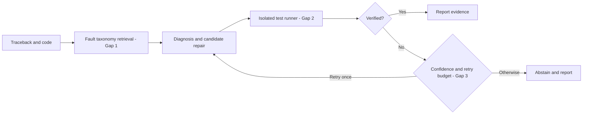

# FaultPilot architecture

**Phase 1 implementation**: A -> B -> deterministic diagnosis -> local subprocess reproducer -> JSON report. The candidate repair / retry / LLM and VS Code integration are later-stage work; do not claim implemented.

State contract: `case_id`, `traceback`, `category`, `confidence_proxy`, `reproduction_passed`, `diagnosis`, `repair_hint`, `evidence`, `status`.

Security: the Phase 1 demo executes Python `-c` code from local case JSON. Run only trusted cases. Later agent-suggested commands must use explicit allowlists and disposable containers; they must never be passed to this runner directly.
